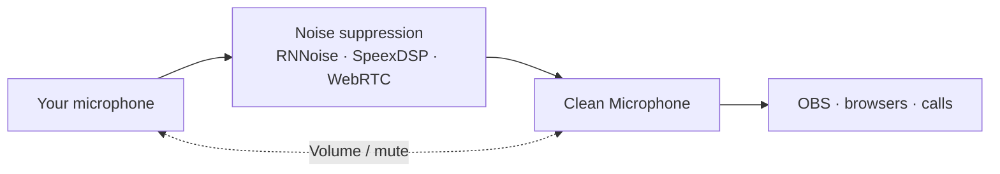

# GNOME Noise Cancellation

<p align="center">
  
</p>

A lightweight **GNOME 51 / PipeWire** extension that gives your apps a
noise-suppressed **Clean Microphone**. CPU processing, local audio, no cloud.



Select a physical microphone and enable it from Quick Settings. Choose
**Clean Microphone** in your apps or make it your system default.

- Physical capture sleeps when no app needs it; the virtual microphone stays ready for new apps.
- Clean Microphone shares the selected microphone's volume and mute controls.
- Turning it off hands the current system input back to the selected mic when needed.
- Remembers your preferred microphone across login. Processing always starts disabled.
- Shows the current backend and activity. Settings open in GNOME's preferences window.
- Device loss stops the session and requires explicit selection again. No automatic fallback.

| Backend | Settings |
| --- | --- |
| RNNoise | Installed pretrained model |
| SpeexDSP | Noise attenuation, optional automatic gain and target |
| WebRTC | Suppression level, optional automatic gain and high-pass filter |

All backends include output-level control. Changes apply after disabling and
explicitly enabling again. [Options explained →](docs/PROCESSING_OPTIONS.md)

## Install

Install the [runtime dependencies](docs/DEPENDENCIES.md), then
[download the extension ZIP](https://github.com/bodyash/gnome-noise-cancellation/releases)
or [build and install it locally](docs/DEVELOPMENT.md#install-and-update).
No compiler, custom native helper, LADSPA wrapper or PipeWire configuration is needed.

**Status:** experimental; desktop smoke-tested by the author on Arch/GNOME 51.
Fedora and Debian/Ubuntu have dependency guidance but need desktop testing.
Publication on extensions.gnome.org is planned. [Verification →](docs/VERIFICATION.md)

## Develop

```sh
python3 -B tools/check.py
```

[Full test commands](docs/DEVELOPMENT.md#automated-checks) ·
[Tag releases and CI](docs/DEVELOPMENT.md#github-actions-and-releases) ·
[Architecture and diagrams](docs/ARCHITECTURE.md) · [Release checklist and roadmap](TODO.md) ·
[Report an issue](https://github.com/bodyash/gnome-noise-cancellation/issues) ·
[Engineering guide](AGENTS.md) · [MIT license](LICENSE)
