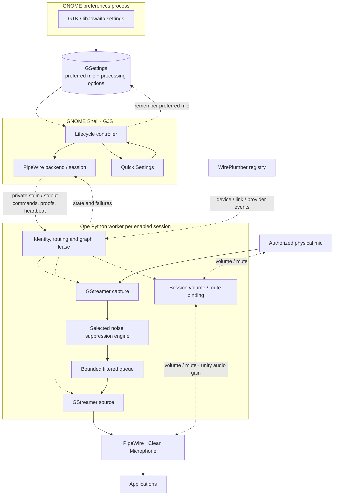
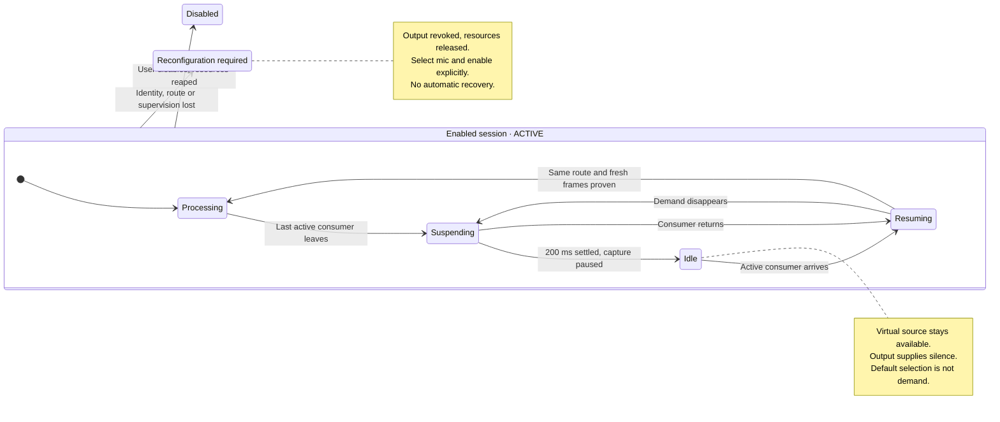

# Architecture

The extension manages one explicitly authorized physical microphone and publishes
**Clean Microphone** through PipeWire. Processing runs in a bundled Python worker;
GNOME Shell handles the UI and lifecycle, never audio samples.

## Processes and ownership



Solid arrows show audio flow or local ownership/settings updates. Dashed arrows
show control and supervision; microphone samples never cross Shell IPC or GSettings.

| Module | Responsibility |
| --- | --- |
| `extension.js`, `core/presentation.js` | Native Quick Settings and snapshot-derived labels |
| `prefs.js`, `preferences/window.js` | Scrollable preferences, saved options and runtime checks |
| `core/controller.js` | Lifecycle, authorization, generations and cleanup |
| `core/processingBinding.js` | Defer the latest saved options until cleanup finishes |
| `core/devices.js`, `core/preferences.js` | Physical-source discovery and stable preference matching |
| `core/settings.js`, `core/dependencies.js` | Validated settings and manual dependency advice |
| `audio/backend.js`, `audio/process.js` | Bounded self-check/discovery and worker creation |
| `audio/session.js` | Private IPC, readiness proofs, heartbeat and child reaping |
| `worker/main.py`, `worker/lifecycle.py` | Protocol, watchdog and graph authorization |
| `worker/routing.py` | WirePlumber registry monitoring and one exact owned link |
| `worker/mixer.py`, `worker/volume.py` | Authorized volume/mute binding through the distro WirePlumber mixer API; bounded acknowledgment and feedback control |
| `worker/streaming.py` | Capture/output, idle transitions and delivery guards |
| `worker/dsp.py`, `worker/engines.py` | RNNoise, SpeexDSP, WebRTC and filtered output level |

Python uses existing PyGObject, GStreamer and WirePlumber 0.5 introspection.
RNNoise and SpeexDSP use typed ctypes bindings to distro libraries; WebRTC uses
an internal device-free GStreamer pipeline. This avoids a separately packaged
custom native executable or plugin. Worker source ships in the extension ZIP.

## Validated startup

```mermaid
sequenceDiagram
    actor User
    participant Shell as Shell controller
    participant Worker as Python worker
    participant Graph as PipeWire / WirePlumber
    User->>Shell: Select physical mic, Enable
    Shell->>Shell: Check dependencies and fresh device identity
    Shell->>Worker: Prepare(session token, identity, frozen options)
    Worker->>Graph: Read selected microphone volume and mute
    Worker->>Graph: Capture with autoconnect disabled
    Worker->>Graph: Create exact physical-port link
    Graph-->>Worker: Pinned identity and unique active route
    Worker->>Worker: Process fresh frames with selected engine
    Worker-->>Shell: Prepared proof + canonical options
    Shell->>Worker: Publish
    Worker->>Graph: Revalidate and create Clean Microphone
    Worker->>Graph: Initialize volume/mute from physical mic; virtual gain stays unity
    Graph-->>Worker: Initial volume acknowledged
    Graph-->>Worker: Owned virtual source confirmed
    Worker-->>Shell: Active proof + virtual source identity
    Shell-->>User: Backend and activity on tile
    Note over Shell,Worker: Cancellation or stale generation stops the worker.<br/>Active is reported only after both proofs pass.
    User->>Shell: Disable extension
    Shell->>Worker: Gio.Subprocess.force_exit()
    Note over Shell,Worker: Cancel IPC and timers immediately.<br/>Retain only asynchronous child reaping.
    Worker-->>Graph: Process exit closes owned connections
    Graph->>Graph: Remove non-lingering source, capture and link
    Note over Shell,Graph: A new session waits for confirmed prior child reaping.<br/>Server-side graph removal follows connection teardown asynchronously.
```

Capture pins the physical source serial and disables autoconnect, fallback and
reconnection. WirePlumber creates an explicit non-lingering link to one physical
port: MONO, then FL, then a sole unambiguous port. Arbitrary multichannel mixing
is not implemented. Capture/output use **48 kHz mono F32**, in 480-sample frames;
PipeWire handles boundary conversion without global rate changes.

RNNoise scales normalized floats to its expected signed-16-bit float amplitude,
processes the installed default model, then rescales/clamps. SpeexDSP preprocesses
S16 frames. WebRTC uses `appsrc → webrtcdsp → appsink` with echo cancellation off.
All engines reject invalid samples. Output gain applies only to filtered audio;
underrun produces silence. There is no raw passthrough or automatic engine substitution.

## Shared microphone volume

Clean Microphone starts with the selected physical microphone's current volume and
mute state. While enabled, changes to either device are mirrored to the other,
including while capture is idle. The binding uses linear SPA amplitudes, so desktop
cubic percentage scaling is preserved. The mono slider represents the physical
device's highest channel volume; virtual edits preserve physical channel balance.
Raising an all-zero source sets each channel to the requested level.

The owned output adapter sets `channelmix.min-volume` and `channelmix.max-volume`
to unity. It reports the mirrored `channelVolumes` to desktop mixers without
applying a second gain to filtered samples; mute remains effective. The separate
saved DSP output-level option still applies after suppression. Virtual volume
restoration is disabled: the source is authoritative at startup, and initial
volume acknowledgment gates publication/activity. No physical volume is written
to initialize the virtual source.

The standard distro WirePlumber mixer API handles device Route versus node Props
controls. Its change signals only schedule graph revalidation. Volume writes run
after the lifecycle verifies identities/providers and, once output exists, the
owned exact route. Physical writes are serialized; newer virtual edits coalesce
while a write is pending, and actual hardware rounding is mirrored back. Physical
edits win simultaneous changes. Missing controls, rejected writes or a two-second
acknowledgment timeout revoke the session. Closing cancels the owned mixer load,
disconnects signals and permanently stops synchronization. The physical mic keeps
its last user-requested level after disable; no volume state is saved in GSettings.

## Idle and resume within an authorized session

The controller remains `ACTIVE` while the virtual source is published. Its
activity tells the UI whether physical capture is processing, suspending, idle
or resuming. The following diagram shows those activities and invalidation:



Only active outgoing consumer links demand capture. A system default preference
or a paused/corked connection does not. OBS preview and sound-settings level meters
can keep a recording connection active even when nothing is being saved.

Delivery closes immediately when demand disappears. A single state-change thread
waits up to 200 ms for the gap to settle before native PAUSED, avoiding churn when
apps switch devices. Sustained idle resets DSP history/partial frames and flushes
buffered output. Consumer return wakes the wait; delivery stays gated until the
same route and fresh processing are proven. Transitions have an eight-second limit.

Capture and output have independent pipelines. The virtual source stays registered
as `noise_cancellation.clean_microphone` with a per-session ownership tag. Output
uses a system clock and synchronized sink to serve paced silence while capture
sleeps. The extension never changes the system default or hides privacy indicators;
the indicator can linger during setup/resume and the idle settling window.

Callbacks use zero-timeout sample pulls. A late `new-sample` callback after PAUSED
must never wait for PLAYING; EOS/errors remain authoritative on the bus. Delivery
generations reject frames spanning a closed gate. Capture generations prevent an
old callback's frame-count increment from being mistaken for fresh resume evidence.
Native state changes never block the GLib linking/supervision thread.

## Authorization and cleanup

Shell states are `UNAVAILABLE`, `SETUP_REQUIRED`, `DISABLED`, `STARTING`, `ACTIVE`,
`STOPPING`, `RECONFIGURATION_REQUIRED` and `ERROR`. The controller owns transitions;
the UI displays snapshots. Operation generations reject stale discovery and startup
callbacks. `STOPPING` lasts until the owned child is reaped. Cleanup failure blocks
future activation. Repeated enable calls cannot create overlapping workers.

Authorization pins the server cookie, source/device serials, stable physical
properties, port/link incarnations and relevant WirePlumber providers. Auxiliary
clients and unrelated Bluetooth devices are not dependencies of a USB mic session.
Loss or replacement of any required object permanently revokes the session.
Replug, settings edits or consumer arrival cannot revive it.

Saved preference matching is separate from live authorization. Only a unique
hardware+endpoint match may restore selection, **disabled**, during a ten-second
login discovery window with at most five read-only retries. Names and transient IDs
alone cannot authorize a source. Invalidating a session clears current selection,
but retains the preference for a future login. Explicit reconfiguration prevents
replacement hardware or changed graph IDs from silently authorizing another input.

Preferences may be edited at any time. The controller freezes the current options
through startup, processing and teardown. After cleanup, only the latest valid
saved snapshot applies; it never starts audio. The worker echoes canonical options
with its readiness/activity proofs. Missing optional engines are checked independently.

Normal tile-off revokes first, requests graceful worker termination, and escalates
to forced termination after 750 ms if needed. The controller stays STOPPING until
the child is reaped. In the worker, normal cleanup stops pipelines before freeing
DSP state and disconnects registry callbacks and owned links.

GNOME extension `disable()` uses **immediate termination** through the owned
`Gio.Subprocess.force_exit()`, including during startup or an existing graceful
stop. Termination runs before signal/widget teardown; a desktop cleanup exception
cannot bypass it or prevent attempts to release the remaining UI resources. Heartbeat, escalation and discovery timers are removed immediately; IPC is
cancelled and late worker messages are ignored. Discovery children are also killed.
Only an asynchronous wait/reap barrier survives unload. A subsequent explicit
enable waits for that barrier before creating an audio worker; uncertain cleanup
blocks it. Shell never blocks waiting for process exit and GNOME need not await
`disable()` for termination to be requested.

Process exit closes every owned PipeWire connection, so non-lingering source,
capture and link objects are removed by the server. That notification/removal is
asynchronous; `disable()` cannot synchronously certify the remote graph vanished.
Forced exit relies on kernel descriptor cleanup rather than Python finally handlers.
Only owned processes/resources are terminated; idle suspension is a separate path
that intentionally retains the virtual source.

All runtime paths derive from the installed module URI, sibling Python paths,
PATH lookups or system library discovery. No developer home or checkout location
is embedded. A relocation test imports a copied extension installed under a path
with spaces and runs its real worker self-check from an unrelated directory.

## Supervision and limits

Each output callback checks permanent revocation and a **1.5 s graph lease**.
A Python watchdog also monitors GLib progress, capture stalls and a **2.5 s parent
heartbeat limit**. Private-pipe EOF, Linux parent-death SIGKILL and bounded parent
SIGTERM/SIGKILL/reaping provide additional shutdown paths.

Python is not hard real-time. Registry notifications and scheduling have latency;
already queued downstream audio cannot be recalled. A fully stalled interpreter
also stalls its watchdog, although it stops producing new Python buffers.
Fault-to-silence latency, load behavior and hardware rate conversion need measured
integration tests. [Current verification](VERIFICATION.md) separates user desktop
reports, native synthetic tests and mocked lifecycle coverage.

## References

- [GNOME Shell Quick Settings](https://gjs.guide/extensions/topics/quick-settings.html)
- [RNNoise API](https://github.com/xiph/rnnoise/blob/main/include/rnnoise.h)
- [GStreamer appsink](https://gstreamer.freedesktop.org/documentation/applib/gstappsink.html)
- [GStreamer appsrc](https://gstreamer.freedesktop.org/documentation/app/appsrc.html)
- [WirePlumber Core](https://pipewire.pages.freedesktop.org/wireplumber/library/c_api/core_api.html)
- [WirePlumber Link](https://pipewire.pages.freedesktop.org/wireplumber/library/c_api/link_api.html)
- [WirePlumber service providers](https://pipewire.pages.freedesktop.org/wireplumber/daemon/configuration/features.html#support-components)
