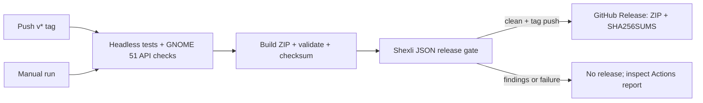

# Development and local testing

Run commands from the repository root. No native build or dependency installation
is part of packaging/testing. See [runtime packages](DEPENDENCIES.md) first.

## Check dependencies

```sh
python3 -B -I extension/worker/main.py --check-all
gjs -m tools/diagnose.js
```

The worker check never connects to PipeWire. Top-level `ready` covers common
runtime APIs; inspect each `backends` entry for engine availability. `--check`
is the RNNoise-only check. The diagnostic adds bounded read-only server discovery.
Neither check creates an audio pipeline on the desktop.

## Install and update

UUID: `noise-cancellation@bodyash.github.io`.

If you installed the earlier development UUID, disable it before installing this
public identity; GNOME treats these as separate extensions. Optionally uninstall
the old copy afterward. Do not enable both:

```sh
gnome-extensions disable noise-cancellation@gnome-noise-cancellation.local
```

The saved GSettings schema/path is unchanged, so preferences remain available.
Changing the identity does not automatically install or migrate a running copy.

```sh
python3 tools/pack.py
gnome-extensions disable noise-cancellation@bodyash.github.io
gnome-extensions install --force build/noise-cancellation@bodyash.github.io.shell-extension.zip
```

Skip `disable` for a first installation. On Wayland, **log out and back in** so
Shell loads the updated code/schema, then:

```sh
gnome-extensions enable noise-cancellation@bodyash.github.io
```

Open Quick Settings → Noise Cancellation, select a physical microphone and enable.
Choose **Clean Microphone** in your application or as the system default. The tile
shows the running backend and activity, such as **SpeexDSP · Active** or **RNNoise · Idle**.
The worker starts/stops with the session; no terminal worker or PipeWire config is needed.

A uniquely matched preferred microphone can be selected disabled at the next login.
Unplug or identity loss revokes the current session: replug never selects or starts
it again in that extension lifecycle. Select explicitly, then enable.

Open **Settings…** in the menu, use the Extensions app, or run:

```sh
gnome-extensions prefs noise-cancellation@bodyash.github.io
```

Saved edits apply after disabling and cleanup; explicitly enable to use them.
Rapid clicks during startup cancel safely. While **Stopping**, a second worker
cannot start; wait for **Disabled** before enabling again.
[Processing options](PROCESSING_OPTIONS.md) explains the controls.

Disabling the GNOME extension itself immediately force-terminates its worker and
probe children through Gio.Subprocess, cancels timers/IPC and removes the UI.
Process exit closes the virtual microphone's owned PipeWire connections; the
server removes its non-lingering objects asynchronously. Re-enable cannot start
audio before prior child reaping finishes. Screen lock uses this same path when
GNOME calls `disable()` in the default user session mode.

### Temporary testing

There is no universal load-a-ZIP-for-one-session command. A nested GNOME 51 session
can isolate UI tests where supported; inspect your build's `gnome-shell --help`.
A nested Shell can share the real desktop audio server, so audio isolation requires
a separate PipeWire instance. Wayland does not support the X11 Alt+F2 `r` reload.
The automated checks below need neither extension installation nor desktop activation.

## Automated checks

Run the complete headless suite, build and archive validation:

```sh
python3 -B tools/check.py
```

This requires the installed development/runtime tools below, but no GNOME desktop,
microphone or running audio server. It isolates GSettings, registry caches and
audio/session-bus endpoints. Missing tools or a failing suite stop the sequence.
To run stages individually:

```sh
glib-compile-schemas --strict extension/schemas
python3 -B -m unittest discover -s tests -p 'test_*.py' -v
gjs -m tests/run.js
gjs -m tests/process.js
gjs -m tests/dependencies.js
gjs -m tests/session.js
gjs -m tests/extension-unload.js
gjs -m tests/backend.js
gjs -m tests/settings.js
gjs -m tests/processing-binding.js
gjs -m tests/presentation.js
gjs -m tests/routing-report.js
gjs -m tools/validate-preferences.js
python3 tools/pack.py
gjs -m tests/preferences.js
python3 tools/validate.py
git diff --check
```

Tests use existing GJS and Python unittest, deterministic fake graphs/processes,
real DSP libraries and synthetic GStreamer samples. They do not capture a microphone,
write audio files or modify the live graph. Preference tests use memory GSettings;
the runner first compiles the local schema needed by those tests. Local GStreamer
registry caches stay under `build/`. For other diagnostics in a restricted workspace,
set `GST_REGISTRY="$PWD/build/gst-registry.bin"`.

Optional Arch GNOME 51 static import check (no actors constructed):

```sh
LD_LIBRARY_PATH=/usr/lib/gnome-shell:/usr/lib/mutter-51 GI_TYPELIB_PATH=/usr/lib/gnome-shell:/usr/lib/mutter-51 gjs -m tools/validate-shell.js
```

Optional native preferences widget test:

```sh
python3 tools/test-preferences.py
```

It needs existing `gtk4-broadwayd` and permission to bind a private Unix socket.
It uses memory GSettings, a fake runtime probe and workspace-local caches. Report a
blocked socket/display rather than falling back to the live desktop. Static
preferences checks need no display. See [verification evidence](VERIFICATION.md).

## GitHub Actions and releases

[The workflow](../.github/workflows/release.yml) runs on pushed `v*` tags, or manually
from Actions → **Test and release** → **Run workflow**. Manual runs perform all
checks and retain artifacts without publishing. Commit and push the source and
workflow to your GitHub repository first; then, for example:

```sh
git tag v1.0.0
git push origin v1.0.0
```

Use a new tag for each release. Tags containing `-`, such as `v1.0.0-rc.1`, create
prereleases. Keep the source `metadata.json` version at **1**; do not increment it
for edits or builds. Git tags identify GitHub releases. GNOME Extensions controls
its own submission numbers and overrides the integer on uploaded packages.
See the official [version guidance](https://gjs.guide/extensions/overview/anatomy.html#version).



Tests/build run in a disposable official Arch container on a GitHub-hosted Ubuntu
runner. CI installs its declared GJS, GNOME, Python, GStreamer, WirePlumber and DSP
packages there only. All 159 JavaScript cases and Python suites, including native
synthetic samples for all three engines, run without starting Shell or PipeWire.
The optional native GTK widget test and real desktop/hardware tests remain manual.
Arch is rolling: a future Shell major version may require updating the CI image
strategy and compatibility checks; a mismatched Shell must fail visibly.

A separate Ubuntu job installs pinned Shexli 0.2.1 and its parser dependencies in
a private Python 3.12 virtual environment. It verifies the checksum and scans the
**built ZIP**, excluding repository tests, CI files and build caches. Findings,
including warnings/manual-review items, block publication except for the precise
Shell 51 tool limitation documented below.
Crashes, missing dependencies and invalid/incomplete JSON also block the release.
The JSON report is retained as `shexli-report` for seven days when produced.
Shexli's current [CLI](https://github.com/GNOME/extensions-web/blob/master/shexli/shexli/cli.py)
returns zero even with findings, so `tools/check-shexli.py` enforces a clean report.
Analyzer/parser versions are pinned together to keep gate changes deliberate.

Shexli 0.2.1 incorrectly rejects the stable `51` metadata target (EGO-M-004).
The GNOME website has [approved Shell 51 submissions with the same finding](https://extensions.gnome.org/review/75368).
The gate permits **only** this sole error from installed analyzer 0.2.1/spec
2026-04-02, with exact metadata evidence and the actual checksummed ZIP declaring
`["51"]`. It does not change the ZIP, rewrite the report or skip the rule wholesale.
The original JSON remains in the artifact and Actions emits a visible warning.
Any additional finding, mismatched evidence, malformed result, future analyzer
version or different target still blocks publication. The preceding job separately
validates metadata and real installed GNOME 51 APIs. Remove this compatibility
exception when upgrading to an analyzer that recognizes 51.

After both jobs pass, the publish job verifies the checksum again and uploads the
ZIP and `SHA256SUMS` to a GitHub Release with generated notes. It uses GitHub's
built-in token; only this job has `contents: write`. No personal token is needed.
Actions dependencies use full commit pins. `extension-release` is a seven-day
intermediate artifact; the GitHub Release assets are the published downloads.
Existing releases/assets are never silently overwritten.

The first hosted test/build job passed, and the user supplied Shexli's three-finding
report: excessive log call sites, tile/menu signal cleanup and the version error
above. Runtime fixes and compatibility-policy tests pass locally; a hosted rerun
must confirm the revised analyzer result. Run the workflow manually before tagging;
inspect findings and resolve review
requirements first. Ensure the public repository URL in metadata is reachable.
After pushing fixes, start a **new** manual run on the updated branch. GitHub's
[Re-run jobs](https://docs.github.com/en/actions/how-tos/manage-workflow-runs/re-run-workflows-and-jobs)
uses the original commit, so rerunning the old failure will not include new fixes.
A clean static report does not establish desktop correctness or GNOME review approval.

## Manual desktop validation

These tests can change routing; run them deliberately on your own desktop or an
isolated audio session. Do not restart production services as routine validation.

1. Inspect `pw-dump` and `pw-link -l` before/after enable. Confirm the selected
   Node/Device serials, capture port and unique owned link. Clean Microphone should
   appear only after validated startup; disable must remove it, its worker and link.
2. Test each installed backend in OBS or another capture application. Check clean
   audio before/after idle, quiet speech, noise, headroom and pending settings changes.
3. Close/cork all consumer connections. Confirm physical capture suspends while the
   source remains listed; setting it as default alone must not resume capture.
   Open/close one and multiple consumers; check freshness, clipping and latency.
   OBS preview/settings meters may keep a connection open without recording.
4. Toggle rapidly, change settings during startup/active/teardown and unload the
   extension. Require one worker maximum, bounded cleanup and no automatic restart.
   With OBS using Clean Microphone, run `gnome-extensions disable` for the UUID.
   Confirm the worker, capture/link and Clean Microphone disappear. Inspect with
   `pgrep -af 'noise-cancellation@bodyash[.]github[.]io/worker/main[.]py.*--session'`
   (no matches expected) and `gjs -m tools/diagnose.js --routing`. Repeat while
   starting/stopping, across rapid extension re-enable, and with screen lock/unlock.
5. Unplug/replug during startup, processing and idle. Replacement, route loss or
   required-service loss must stop output and require fresh selection. Test service
   restarts and fault injection only in a disposable audio session.
6. Connect/disconnect unrelated Bluetooth devices while using a USB mic. The USB
   session should remain authorized. Verify preference matching after login with
   changed graph IDs and with ambiguous/absent devices.
7. Test real hardware 44.1/48/96 kHz conversion and channel layouts. Measure CPU,
   fault-to-silence timing and long-idle resume instead of inferring them from mocks.
8. Resize preferences, edit repeatedly and close/reopen. Inactive options must
   persist; missing engines must show actionable errors without substitution.

## Debug

```sh
journalctl --user -b --no-pager -o cat --grep='NoiseCancellation'
gjs -m tools/diagnose.js --devices
gjs -m tools/diagnose.js --routing
```

Use `journalctl --user -b -1` for the previous boot. Looking Glass shows Shell
errors. The menu retains the last bounded problem across login. Input details and
routing reports omit stable serials/session tags; redact raw dumps before sharing.
No microphone audio or untrusted worker stderr is logged.

For silence while **Active**, collect `--routing` before changing backend/microphone
or restarting the session. It reports source/capture/consumer links, node states
and available mute/volume metadata without starting a worker or capturing audio.
A report after recovery cannot establish the failing state.

A brief **Suspending** label is normal: output is gated immediately, then idle
settles for 200 ms before native pause. A timeout includes native stage, capture/
link status and fresh-frame evidence; include that complete message in a bug report.
GNOME's privacy indicator is expected during real capture and setup/resume; apps
using the physical mic directly can keep it visible. The extension never hides it.

## Remove

Normal shutdown releases owned resources. No PipeWire files, models or recordings
need removal. To remove saved preferences as well, disable first and optionally
reset GSettings before uninstalling:

```sh
gnome-extensions disable noise-cancellation@bodyash.github.io
GSETTINGS_SCHEMA_DIR="$HOME/.local/share/gnome-shell/extensions/noise-cancellation@bodyash.github.io/schemas" gsettings reset-recursively org.gnome.shell.extensions.noise-cancellation
gnome-extensions uninstall noise-cancellation@bodyash.github.io
```

Adjust the schema path if `XDG_DATA_HOME` differs. `build/` contains disposable
local artifacts. No separate helper package was installed.

## Publication

See the [review audit](REVIEW.md) for rule checks, the precise Shell 51 analyzer
limitation and the Python-worker submission rationale.

The project URL is `https://github.com/bodyash/gnome-noise-cancellation`, with
issues at `/issues`. Required metadata includes the public UUID, name, description,
GNOME version and project URL; the schema key is needed for this extension's
preferences. No author, email, donation or icon metadata key is required.
Freeze the public UUID after first publication so existing users receive updates.

For an experimental **GitHub release**, push the public repository, run the
workflow manually, smoke-test the resulting ZIP using the public UUID, then push
the release tag. Verify that the ZIP and checksum are downloadable. The
[short checklist](../TODO.md) keeps remaining release steps separate from future
testing work. Missing Fedora/Debian hardware coverage does not prevent an
experimental release, provided compatibility claims remain accurate.

For **extensions.gnome.org**, upload the ZIP for review and upload listing images
separately through the listing's edit controls. The icon's filename has no special
meaning: root `icon.png` is used only for the README and is excluded from the ZIP.
The existing 1254 × 1254 artwork needs a smaller listing export: the website
currently requires at most **512 × 512 pixels** and a file no larger than **2 MiB**.
Do not just rename the file to change its dimensions. A screenshot of the compact
Quick Settings menu/preferences will help users understand the extension.
These limits come from the website's
[image-upload implementation](https://github.com/GNOME/extensions-web/blob/master/sweettooth/extensions/views.py).

The ZIP contains readable GJS/Python source and the MIT license. Python ctypes
allows existing DSP libraries to run outside Shell without a custom native binding.
The bundled script needs GNOME review; this rationale is not acceptance.
See [GNOME's scripts/binaries review policy](https://gjs.guide/extensions/review-guidelines/review-guidelines.html#scripts-and-binaries).
